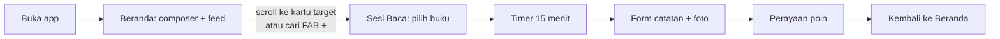
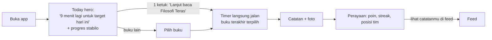

# ReadQuest — Alur UX

## Loop inti: buka app → baca 15 menit → tulis catatan → dapat poin & respons tim

### Sebelum

Masalah: di HP, kartu target ada di bawah composer; ada 4 jalan ke sesi baca (composer, kartu target, FAB, menu) dan tidak satu pun menyebut buku yang sedang dibaca. Pengguna harus memilih buku lagi setiap kali.

### Sesudah

Perubahan: satu CTA utama yang menyebut buku terakhir (kurangi 1 langkah), tombol "Baca" tetap di tengah bottom nav di semua halaman, FAB dihapus.

## Hierarki 3 detik per halaman

| Halaman | Yang harus terlihat dalam 3 detik | Sekunder |
|---|---|---|
| Beranda | Sisa menit hari ini + CTA lanjut baca | Rekan yang sudah membaca, feed |
| Sesi Baca | Buku terpilih + timer | Ganti buku, mode 5 menit |
| Feed / post | Isi catatan + buku | Reaksi, komentar |
| Peringkat | Posisimu + jarak ke peringkat di atasmu | Podium, kategori |
| Quest | Quest terdekat selesai | Quest lain, hadiah |
| Statistik tim | Partisipasi hari ini & 7 hari | Grafik harian, per fungsi |
| Profil | Nama, level, streak | Badge, postingan, rak |
| Katalog | Cari + sampul buku | Kategori, tambah buku |
| Admin dashboard | Pembaca aktif + tren 30 hari | Heatmap, observer list |
| Login | Form HP + PIN | Daftar, lupa PIN |

## Navigasi

- HP: bottom nav `[menu][menu][Sesi baca][menu][Lainnya]` — 3 menu mengikuti urutan Admin, tombol **Sesi baca** selalu di tengah.
- Desktop: sidebar kiri (item aktif ditandai stabilo), tombol "Mulai membaca" di header, panel kanan ringkasan.
